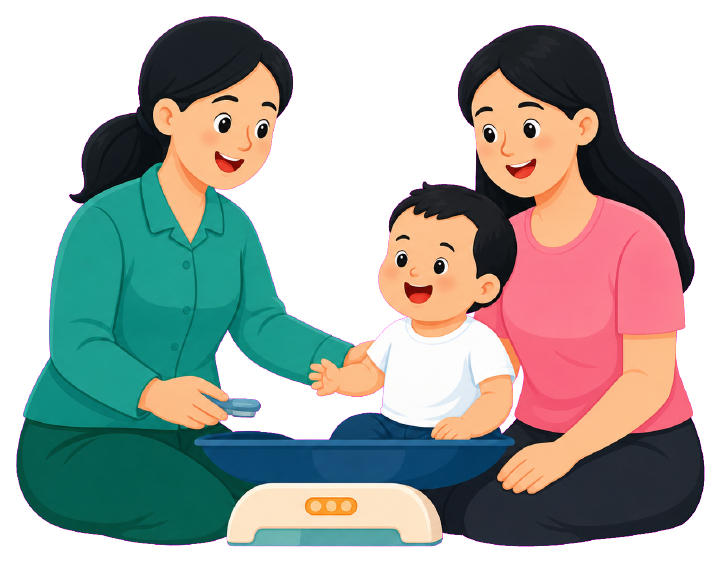

<div align="center">



# Posyandu Merpati

**Sehat Balita, Bahagia Keluarga**

Aplikasi manajemen posyandu berbasis Android untuk memantau kesehatan balita,
mencatat imunisasi, menampilkan grafik pertumbuhan, dan mengirim notifikasi real-time.


</div>

---

## Daftar Isi

- [Tentang Aplikasi](#tentang-aplikasi)
- [Tampilan Aplikasi](#tampilan-aplikasi)
- [Fitur](#fitur)
- [Teknologi](#teknologi)
- [Arsitektur](#arsitektur)
- [Struktur Folder](#struktur-folder)
- [Status Gizi dan Perhitungan Umur](#status-gizi-dan-perhitungan-umur)
- [Sistem Notifikasi](#sistem-notifikasi)
- [Database](#database)
- [Cara Menjalankan](#cara-menjalankan)
- [Testing](#testing)
- [Dokumentasi Lain](#dokumentasi-lain)

---

## Tentang Aplikasi

Posyandu Merpati membantu kader dan orang tua dalam satu aplikasi:

- **Kader** mengelola data balita, mencatat imunisasi serta berat dan tinggi badan,
  mengatur jadwal posyandu, memantau balita yang perlu perhatian, dan mencetak laporan.
- **Orang tua** mendaftarkan balita, melihat grafik pertumbuhan dan status gizi,
  memantau riwayat serta agenda imunisasi, membaca edukasi, dan menerima notifikasi.

Aplikasi punya dua role. Setelah login, role dibaca dari tabel `profiles` lalu pengguna
diarahkan otomatis:

| Role | Tujuan |
|------|--------|
| `kader` | Dashboard Kader |
| `orang_tua` | Dashboard Orang Tua |

Studi kasus: **Posyandu Merpati**.

## Tampilan Aplikasi

Tangkapan layar diambil dari emulator Android (debug build).

<table>
  <tr>
    <td align="center"><br /><sub><b>Login</b></sub></td>
    <td align="center"><br /><sub><b>Daftar Akun Orang Tua</b></sub></td>
    <td align="center"><br /><sub><b>Lupa Password</b></sub></td>
  </tr>
</table>

Palet warna utama memakai teal (`#00897B`) dengan latar mint lembut. Warna status gizi
(hijau, kuning, oranye, merah) didefinisikan di
[app_colors.dart](lib/core/constants/app_colors.dart).

## Fitur

### Kader

| Modul | Kemampuan |
|-------|-----------|
| **Dashboard** | Rekap total balita, imunisasi bulan ini, balita menunggu verifikasi, jadwal terdekat, dan notifikasi terbaru |
| **Data Balita** | Tambah, lihat, cari (nama atau NIK), ubah, dan hapus data balita |
| **Verifikasi Balita** | Setujui atau tolak balita yang didaftarkan orang tua (status `pending`) |
| **Monitoring Balita** | Daftar balita dengan status gizi terakhir, kartu "Perlu Perhatian" di beranda |
| **Imunisasi** | Input hasil imunisasi, riwayat, generate jadwal imunisasi otomatis dari tanggal lahir |
| **Pertumbuhan** | Input berat, tinggi, dan lingkar kepala dengan status gizi otomatis |
| **Master Imunisasi** | Kelola jenis imunisasi (HB0, BCG, Polio, DPT-HB-Hib, Campak/MR, dan lainnya) |
| **Jadwal Posyandu** | Buat, ubah, dan hapus agenda kegiatan (judul, deskripsi, tanggal, jam, lokasi) |
| **Laporan** | Laporan balita, imunisasi, pertumbuhan, dan jadwal imunisasi dalam format PDF atau Excel |
| **Edukasi** | Kelola artikel edukasi beserta kategorinya |
| **Manajemen Pengguna** | Kelola akun pengguna |
| **Profil** | Ubah profil dan ganti password |

### Orang Tua

| Modul | Kemampuan |
|-------|-----------|
| **Register dan Login** | Buat akun, masuk, dan reset password lewat email |
| **Registrasi Balita** | Daftarkan balita, status awal `pending` sampai diverifikasi kader |
| **Pertumbuhan** | Grafik berat dan tinggi badan menurut usia (bulan) dengan status gizi per pemeriksaan |
| **Riwayat Imunisasi** | Daftar imunisasi yang sudah diterima balita |
| **Agenda Imunisasi** | Jadwal imunisasi berikutnya berdasarkan umur balita |
| **Agenda Posyandu** | Kegiatan posyandu yang akan datang |
| **Notifikasi** | Hasil imunisasi, reminder jadwal, pengumuman posyandu, dan status verifikasi balita |
| **Edukasi** | Baca artikel edukasi |
| **Profil** | Ubah profil |

### Umum

Pengaturan notifikasi, pusat bantuan, dan kebijakan privasi tersedia untuk kedua role.

## Teknologi

| Bagian | Teknologi |
|--------|-----------|
| Framework | Flutter, Dart |
| Backend | Supabase (Auth, PostgreSQL, Realtime, Storage, Edge Functions, `pg_cron`) |
| State management | Provider |
| Push notification | Firebase Cloud Messaging (`firebase_messaging`) |
| Notifikasi lokal | `flutter_local_notifications` |
| Grafik | `fl_chart` |
| Kalender | `table_calendar` |
| Laporan | `pdf`, `printing`, `excel`, `open_file`, `share_plus` |
| Lainnya | `shared_preferences`, `image_picker`, `cached_network_image`, `permission_handler`, `intl` |

## Arsitektur

Pemisahan lapisan mengikuti aturan berikut:

```
Screen  ──►  Provider  ──►  Repository  ──►  Supabase
(UI)        (state)        (akses data)      (Auth / DB / Realtime)
```

1. Screen tidak mengakses Supabase langsung.
2. Semua akses database lewat repository.
3. State halaman dikelola Provider (loading, empty state, error).
4. Setiap model punya `fromJson` dan `toJson`.
5. Label UI memakai Bahasa Indonesia, form divalidasi, dan hasil aksi ditampilkan lewat snackbar.
6. Perhitungan umur dan status gizi hanya lewat helper, tidak di screen.

## Struktur Folder

```
lib/
├── main.dart                 # Inisialisasi Supabase, notifikasi, FCM
├── app.dart                  # MaterialApp, MultiProvider, tema
├── core/
│   ├── constants/            # Warna, string, konfigurasi Supabase, daftar kota
│   ├── services/             # Supabase, FCM, notifikasi lokal
│   ├── theme/                # Tema aplikasi
│   ├── utils/                # age_calculator, growth_status_helper, who_growth_data
│   └── widgets/              # Widget umum (loading, empty state, snackbar, dialog, badge)
├── data/
│   ├── models/               # Model dengan fromJson / toJson
│   └── repositories/         # Seluruh akses database
├── features/
│   ├── auth/                 # Splash, login, register, lupa dan reset password
│   ├── kader/                # providers/ dan screens/ untuk role kader
│   ├── orang_tua/            # providers/ dan screens/ untuk role orang tua
│   └── shared/               # Pengaturan notifikasi, pusat bantuan, kebijakan privasi
└── routes/
    └── app_routes.dart       # Seluruh route aplikasi

docs/                         # Skema database, SQL setup, spesifikasi fitur, alur
supabase/
├── functions/send-notification/   # Edge Function pengirim FCM
└── migrations/                    # Migrasi database
test/                         # Unit dan widget test
```

## Status Gizi dan Perhitungan Umur

**Umur balita** dihitung otomatis dalam bulan dari `tanggal_lahir` dan tanggal
pemeriksaan atau imunisasi, lewat
[age_calculator.dart](lib/core/utils/age_calculator.dart). Kader tidak perlu mengisi umur secara manual.

**Status gizi** dihitung oleh
[growth_status_helper.dart](lib/core/utils/growth_status_helper.dart) memakai Z-score
berdasarkan tabel LMS WHO Child Growth Standards 2006 usia 0 sampai 60 bulan
([who_growth_data.dart](lib/core/utils/who_growth_data.dart)). Masukannya adalah berat badan,
tinggi badan, usia dalam bulan, dan jenis kelamin.

| Indikator | Z-score | Status |
|-----------|---------|--------|
| Tinggi menurut umur | < -3 | Stunting |
| Tinggi menurut umur | < -2 | Risiko Stunting |
| Berat menurut umur | < -3 | Gizi Buruk |
| Berat menurut umur | < -2 | Gizi Kurang |
| Berat menurut umur | > 1 | Risiko Gizi Lebih |
| Berat menurut umur | > 2 | Gizi Lebih |
| Berat menurut umur | > 3 | Obesitas |
| Lainnya | | Normal |

Status ditampilkan dengan badge berwarna pada detail pertumbuhan, grafik, dan ringkasan dashboard.

> Perhitungan ini membantu pemantauan di posyandu dan **bukan pengganti diagnosis tenaga kesehatan**.

## Sistem Notifikasi

```
Kader menyimpan imunisasi / memverifikasi balita / membuat jadwal
        │
        ▼
Insert ke tabel notifications (user_id = penerima)
        │
        ├──► Supabase Realtime ──► aplikasi (subscribe per user_id)
        │                              ├─ tampilkan Flutter Local Notification
        │                              └─ perbarui daftar dan badge notifikasi
        │
        └──► Edge Function send-notification ──► FCM ──► perangkat (token di user_devices)
```

Selain itu, `pg_cron` mengirim reminder otomatis H-1 jadwal, notifikasi data balita yang belum
lengkap kepada kader, dan pengingat rekap laporan bulanan di awal bulan.

Jenis notifikasi: `hasil_imunisasi`, `pertumbuhan`, `reminder`, `pengumuman`, `verifikasi`.

## Database

Skema ada di [docs/database_setup.sql](docs/database_setup.sql). Tabel utamanya:

| Tabel | Fungsi |
|-------|--------|
| `profiles` | Profil pengguna dan role (`kader` atau `orang_tua`) |
| `balita` | Data balita, dengan status verifikasi `pending`, `disetujui`, atau `ditolak` |
| `jenis_imunisasi` | Master jenis imunisasi |
| `imunisasi` | Catatan imunisasi yang sudah dilakukan |
| `pertumbuhan` | Berat, tinggi, lingkar kepala, dan status gizi |
| `jadwal_imunisasi` | Jadwal imunisasi: `terjadwal`, `terlambat`, `selesai`, `dibatalkan` |
| `jadwal_posyandu` | Agenda kegiatan posyandu |
| `notifications` | Notifikasi per pengguna |
| `edukasi`, `edukasi_kategori` | Artikel edukasi dan kategorinya |
| `user_devices` | Token FCM per perangkat |

Akses data dibatasi **Row Level Security**. Ringkasnya, kader punya akses penuh ke data
posyandu, sedangkan orang tua hanya bisa membaca dan menambah data balita miliknya sendiri.
Rincian kebijakan ada di [docs/alur.md](docs/alur.md).

## Cara Menjalankan

### Prasyarat

- Flutter SDK 3.44 atau lebih baru (Dart `^3.9`)
- Android Studio dengan Android SDK dan emulator
- Proyek [Supabase](https://supabase.com)
- Proyek [Firebase](https://console.firebase.google.com) dengan Cloud Messaging aktif

### 1. Clone dan pasang dependensi

```bash
git clone https://github.com/Mifta24/posyandu_merpati.git
cd posyandu_merpati
flutter pub get
```

### 2. Siapkan Supabase

1. Buka **SQL Editor** di dashboard Supabase, lalu jalankan [docs/database_setup.sql](docs/database_setup.sql).
   File ini membuat tabel, indeks, fungsi, kebijakan RLS, bucket storage, dan publikasi Realtime.
2. Terapkan migrasi di [supabase/migrations/](supabase/migrations/) (lewat Supabase CLI
   `supabase db push`, atau jalankan berurutan di SQL Editor).
3. Isi URL dan anon key di [supabase_config.dart](lib/core/constants/supabase_config.dart).
4. Tambahkan redirect URL `posyandumerpati://reset-callback` pada **Authentication → URL Configuration**
   agar fitur reset password berfungsi.
5. (Opsional) Untuk push notification, deploy Edge Function:

   ```bash
   supabase functions deploy send-notification
   supabase secrets set FCM_PROJECT_ID=<project-id> FCM_SERVICE_ACCOUNT_JSON='<isi service account JSON>'
   ```

### 3. Siapkan Firebase

Unduh `google-services.json` dari Firebase Console dan letakkan di `android/app/`.
File ini ada di `.gitignore` sehingga tidak ikut ter-commit. Jangan commit file service account.

### 4. Jalankan di emulator Android

```bash
# lihat daftar emulator, lalu jalankan salah satunya
flutter emulators
flutter emulators --launch <id_emulator>

# pastikan emulator terdeteksi
flutter devices

# jalankan mode debug di emulator (contoh: emulator-5554)
flutter run -d emulator-5554
```

Saat `flutter run` aktif: tekan `r` untuk hot reload, `R` untuk hot restart, dan `q` untuk berhenti.

Id aplikasi: `com.mif.posyandu_merpati.posyandu_merpati`

### 5. Build APK

```bash
flutter build apk --release
# hasil: build/app/outputs/flutter-apk/app-release.apk
```

### Pemecahan masalah

| Masalah | Solusi |
|---------|--------|
| Emulator tidak terdeteksi | Jalankan `adb devices`, restart emulator, atau `adb kill-server && adb start-server` |
| Build Gradle pertama lama | Normal, unduhan dependensi hanya terjadi sekali |
| Peringatan versi Kotlin | Hanya peringatan, build tetap berjalan |
| Push notification tidak masuk | Pastikan `google-services.json` benar dan Edge Function sudah di-deploy |
| Reset password tidak membuka aplikasi | Cek redirect URL `posyandumerpati://reset-callback` di Supabase Auth |

## Testing

```bash
flutter test
flutter analyze
```

Cakupan test saat ini: `growth_status_helper`, `growth_status_badge`, `monitoring_balita_merger`, dan widget test dasar.

## Dokumentasi Lain

| Dokumen | Isi |
|---------|-----|
| [docs/feature_spec.md](docs/feature_spec.md) | Spesifikasi fitur per role |
| [docs/alur.md](docs/alur.md) | Alur penggunaan, alur data, dan hak akses RLS |
| [docs/development_plan.md](docs/development_plan.md) | Rencana pengembangan bertahap |
| [docs/database_schema.sql](docs/database_schema.sql) | Skema database |
| [docs/superpowers/specs/](docs/superpowers/specs/) | Desain fitur Monitoring Balita |

---

<div align="center">

Dibuat untuk **Posyandu Merpati**

</div>
